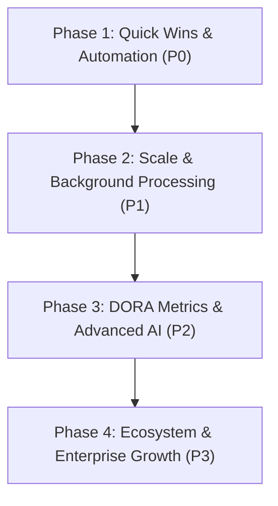

# DevPilot: Future Implementations & Strategic Engineering Roadmap

This document outlines the strategic product and engineering roadmap for **DevPilot v3.0+**, categorized into **Functional Improvements**, **Non-Functional & Architectural Enhancements**, **High-Value New Features**, and an **Implementation Priority Matrix**.

---

## Table of Contents
1. [Platform Overview & Current Foundation](#platform-overview--current-foundation)
2. [Part 1: Functional Improvements (Refining Existing Capabilities)](#part-1-functional-improvements)
   - [1. Kanban & Sprint Lifecycle](#1-kanban--sprint-lifecycle)
   - [2. GitHub & Pull Request Automation](#2-github--pull-request-automation)
   - [3. Timesheets, Approvals & Payroll Export](#3-timesheets-approvals--payroll-export)
   - [4. Nexus² AI & Knowledge Base](#4-nexus-ai--knowledge-base)
   - [5. Team Collaboration & Communication](#5-team-collaboration--communication)
3. [Part 2: Non-Functional & Architectural Enhancements](#part-2-non-functional--architectural-enhancements)
   - [1. Performance & Latency](#1-performance--latency)
   - [2. Security, Auth & Trust Boundaries](#2-security-auth--trust-boundaries)
   - [3. Reliability, Resilience & Observability](#3-reliability-resilience--observability)
4. [Part 3: High-Value New Customer Features (Differentiators)](#part-3-high-value-new-customer-features)
   - [1. DevPilot Autopilot: Story Decomposer & PR Code Reviewer](#1-devpilot-autopilot-story-decomposer--pr-code-reviewer)
   - [2. DORA Metrics & Engineering Health Dashboard](#2-dora-metrics--engineering-health-dashboard)
   - [3. Smart Workload Balancer & Burnout Guard](#3-smart-workload-balancer--burnout-guard)
   - [4. Embeddable Customer Bug Reporter Widget](#4-embeddable-customer-bug-reporter-widget)
   - [5. CI/CD Pipeline Tracking & Incident War Rooms](#5-cicd-pipeline-tracking--incident-war-rooms)
5. [Part 4: Priority & Implementation Roadmap Matrix](#part-4-priority--implementation-roadmap-matrix)

---

## Platform Overview & Current Foundation

DevPilot v3.0 integrates the best paradigms of modern engineering tools:
- **Sprint / Kanban Board**: Optimistic UI updates with real-time editing locks via WebSockets.
- **Git Intelligence**: Multi-task commit parsing, commit-to-task join persistence, and repository commit synchronization.
- **Timesheets**: ClickUp-style 7-day workload matrix with work pattern signals and dynamic week navigation.
- **Nexus² AI**: RAG knowledge retrieval across uploaded workspace documents using HuggingFace embeddings (`pgvector`) and Groq LLM inference.
- **Real-Time Collaboration**: Channels, direct messages, and integrated ZegoCloud video calls.
- **Machine Learning Microservice**: Sprint delivery risk predictions using Random Forest, XGBoost, and CodeBERT feature extractors.

---

## Part 1: Functional Improvements

### 1. Kanban & Sprint Lifecycle
- **Formal Sprint Entities (Start / Complete / Retrospective)**:
  - Introduce dedicated Sprint records (`startDate`, `endDate`, `goal`, `status: PLANNED | ACTIVE | COMPLETED`).
  - Add a **"Complete Sprint"** modal with a velocity summary, burndown metrics, and a 1-click prompt to roll unfinished tasks into the Backlog or next Sprint.
- **Dynamic Burndown & Velocity Charts**:
  - Automatically calculate velocity trends (story points delivered vs. planned) and visualize daily burndown charts based on task completion timestamps.
- **Task Dependencies ("Blocks" / "Blocked By")**:
  - Implement directed dependency links with Directed Acyclic Graph (DAG) cycle checks. Warn or block developers when moving a task to `IN_PROGRESS` if prerequisite tasks are still unresolved.
- **Checklists & Subtasks**:
  - Support hierarchical subtasks with progress bars directly visible on Kanban task cards (e.g., `4/6 subtasks completed`).

### 2. GitHub & Pull Request Automation
- **Pull Request (PR) Lifecycle Webhooks**:
  - Listen for GitHub webhooks: `pull_request.opened`, `pull_request.review_requested`, and `pull_request.closed`.
  - Automatically transition linked tasks:
    - PR Opened → Task moves to **"In Review"**.
    - PR Merged → Task moves to **"Done"** with completion timestamp logged.
- **1-Click Git Branch & PR Creator**:
  - Inside the Task Modal, add a **"Create Branch"** button that utilizes Octokit to create standardized branches (e.g., `feature/DEV-102-auth-fix`) directly in the linked repository.
- **Inline Git Diff Viewer**:
  - Allow developers, QA testers, and reviewers to inspect linked commit and PR diffs inside a modal without navigating away to GitHub.

### 3. Timesheets, Approvals & Payroll Export
- **Manager Approval & Week Locking**:
  - Activate the "Approvals" workflow: allow Project Managers to click **"Approve Week"** or **"Request Revisions"**.
  - Once approved, stamp `isLocked: true` to prevent historical data tampering for payroll compliance.
- **1-Click Payroll & Invoicing Export (CSV / PDF)**:
  - Generate comprehensive timesheet reports broken down by member, billable hours, project tags, and calculated costs based on hourly rates.
- **Smart Time Suggestions from Git Activity**:
  - Provide an opt-in toggle that analyzes daily commit timestamps and pre-populates suggested hours for developers to verify and save with one click.

### 4. Nexus² AI & Knowledge Base
- **Multi-Document Citations with Deep Linking**:
  - When Nexus synthesizes answers from workspace documentation, return interactive reference chips (e.g., `[Architecture_Spec.pdf, Page 14]`). Clicking opens the document viewer scrolled to the exact paragraph.
- **Full Codebase AST Indexing**:
  - Extend vector indexing to codebase source files (`.js`, `.jsx`, `.ts`, `.py`, `.sql`) using AST parsing. Developers can query: *"Where is the JWT token verified in the backend?"* and receive exact code lines and references.

### 5. Team Collaboration & Communication
- **Threaded Replies in Channels**:
  - Add a dedicated side drawer for message threads to keep main channels clean during complex technical problem-solving.
- **In-Chat Task Cards (Unfurling)**:
  - Typing a task identifier (e.g., `#DEV-42`) in chat or document comments automatically renders an interactive card with title, priority badge, assignee avatar, and quick-status dropdown.
- **Notification Inbox & Mentions**:
  - Support `@username` and `@here` mentions with an unread Notification Center (bell icon in header) tracking assignments, review requests, and mentions.

---

## Part 2: Non-Functional & Architectural Enhancements

### 1. Performance & Latency
- **Redis Caching Layer**:
  - Cache high-frequency, read-heavy queries (user project memberships, channel lists, active sprint tasks) with write-through invalidation. Target: Cut p95 API latency to <10ms.
- **Asynchronous Background Queue (BullMQ + Redis)**:
  - Offload heavy tasks (initial 100+ commit repository syncs, multi-page PDF vectorization, batch ML model inference) to dedicated worker threads, ensuring the Express HTTP event loop never blocks.
- **Optimized Composite Database Indexes**:
  - Add compound indexes in PostgreSQL via Prisma:
    - `Message(projectId, isGroup, channelId, createdAt)` for sub-millisecond chat pagination.
    - `TimesheetEntry(projectId, weekDate, userId)` for instant timesheet matrix lookups.
    - `Task(projectId, status, sprintId)` for high-speed Kanban board rendering.

### 2. Security, Auth & Trust Boundaries
- **Webhook Signature Verification**:
  - Validate the `X-Hub-Signature-256` HMAC SHA-256 secret on all GitHub webhook requests to guarantee authenticity.
- **Custom Granular Roles (RBAC Matrix)**:
  - Allow enterprise workspace admins to customize project roles (e.g., toggle whether `DEVELOPER` can invite external members, delete public channels, or view billing rates).
- **API Rate Limiting on AI & Prediction Endpoints**:
  - Enforce per-user sliding-window rate limits on expensive LLM and ML prediction endpoints to prevent API quota exhaustion and denial-of-service spikes.

### 3. Reliability, Resilience & Observability
- **Comprehensive Automated Test Suites**:
  - Supertest API integration suites for authentication, task mutations, and timesheet calculations.
  - Playwright E2E suites covering the core user path: Login → Create Task → Move to In Progress → Log Timesheet.
- **Error Tracking & Application Telemetry (Sentry / OpenTelemetry)**:
  - Monitor uncaught exceptions, React error boundary crashes, and WebSocket disconnect patterns in real time.
- **Graceful WebSocket Reconnection & Offline Queue**:
  - Implement exponential backoff reconnection and client-side message queueing in Socket.IO stores so temporary network fluctuations do not lose in-flight chat messages or drag-and-drop state.

---

## Part 3: High-Value New Customer Features

### 1. DevPilot Autopilot: Story Decomposer & PR Code Reviewer
- **AI Story Decomposer**: Product Managers provide a high-level user story (e.g., *"Implement Stripe Subscription Billing"*). DevPilot breaks it down into technical subtasks (frontend UI, backend webhook handler, database migrations, unit tests) with estimated effort points.
- **Automated PR Reviewer**: When a PR is submitted, DevPilot cross-references the code diff against the linked task's acceptance criteria, automatically flagging missing tests, security vulnerabilities, and edge cases.

### 2. DORA Metrics & Engineering Health Dashboard
Track the 4 industry-standard DevOps Research and Assessment (DORA) metrics automatically from Git webhooks and sprint timestamps:
1. **Deployment Frequency**: How often code is successfully shipped to production.
2. **Lead Time for Changes**: Time elapsed from first commit to production deployment.
3. **Change Failure Rate**: Percentage of deployments requiring immediate hotfixes or rollbacks.
4. **Mean Time to Recovery (MTTR)**: Time elapsed to resolve a production incident.

### 3. Smart Workload Balancer & Burnout Guard
- Using timesheet hours, sprint task allocations, and the ML delivery prediction microservice, calculate a real-time **Workload Capacity Gauge**:
  - Example Alert: *"Alex is assigned 54 hours of work across 4 high-priority tasks (135% capacity). Reassigning DEV-84 is recommended to prevent sprint delivery delay."*
  - Predicts sprint delivery probability with a confidence percentage before deadlines are missed.

### 4. Embeddable Customer Bug Reporter Widget
- A lightweight React package or `<script>` tag that clients embed in their web applications.
- When an end-user encounters a bug, they click "Report Issue". The widget captures a screenshot, console logs, and network errors, automatically filing a triaged ticket on DevPilot’s backlog with full reproduction context.

### 5. CI/CD Pipeline Tracking & Incident War Rooms
- Render live GitHub Actions / GitLab CI build badges directly on task cards.
- If a production deployment fails, a **"Launch Incident War Room"** button appears. Clicking it spins up an urgent incident channel, notifies on-call team members, and launches a 1-click ZegoCloud video conference with the failing commit diff pre-loaded.

---

## Part 4: Priority & Implementation Roadmap Matrix

| Phase | Category | Feature / Initiative | Target Impact | Est. Effort |
| :--- | :--- | :--- | :--- | :--- |
| **P0** | Automation | **GitHub PR Webhook Automation** (Auto-move tasks on PR open/merge) | High (Immediate daily workflow improvement) | 1–2 Days |
| **P0** | Compliance | **Timesheet Lock & CSV/PDF Export** | High (Client billing & payroll ready) | 1–2 Days |
| **P1** | Architecture | **BullMQ Background Job Queue** (Non-blocking Git sync & vectorization) | Critical (Server stability under load) | 2–3 Days |
| **P1** | UX Polish | **Threaded Chat Replies & In-Chat Task Cards** | Medium (Communication clarity) | 3–4 Days |
| **P1** | Reliability | **Automated Integration & E2E Test Suites** (Supertest + Playwright) | High (Prevents deployment regressions) | 3–5 Days |
| **P2** | Intelligence | **DORA Metrics & Engineering Health Dashboard** | High (Key enterprise sales differentiator) | 1 Week |
| **P2** | AI Agent | **AI Story Decomposer & PR Code Reviewer** | High (Major competitive advantage over Jira) | 1–2 Weeks |
| **P3** | Ecosystem | **Embeddable Bug Reporter Widget SDK** | Medium (Expands user acquisition) | 1–2 Weeks |
| **P3** | Operations | **CI/CD Build Tracking & 1-Click Incident War Rooms** | High (DevOps & incident response) | 1 Week |
